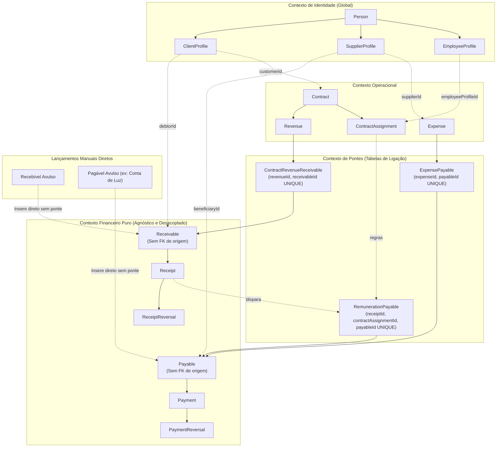
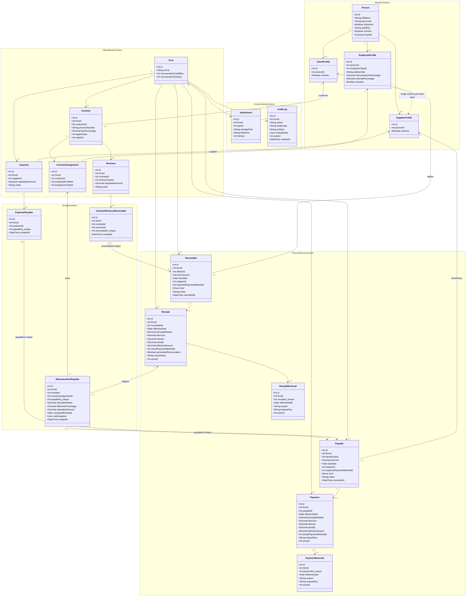
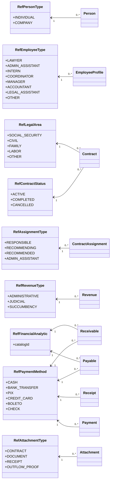

# Financial System UML — Target Decoupled Architecture

Este documento define os diagramas canônicos da arquitetura desacoplada do sistema.
Toda a modelagem baseia-se no isolamento estrito entre contextos de negócio e uso de tabelas de ponte.

---

## 1. Visão de Bounded Contexts

---

## 2. Diagrama de Classes do Domínio

---

## 3. Catálogos Globais (`ref_*`)

---

## 4. Invariantes da Arquitetura Desacoplada

1. **Pureza de Título**: `Receivable` e `Payable` não contêm colunas FK de `Revenue`, `Expense`, `Contract` ou código de geração.
2. **Classificação Nativa (`kind`)**: Classificação do título é um enum estrito no título (`DOWN_PAYMENT`, `INSTALLMENT`, `EXTRA`), sem tabela externa de lookup.
3. **Ponte Única por Título**: `receivableId` em `ContractRevenueReceivable` e `payableId` em `ExpensePayable`/`RemunerationPayable` são restritos por `UNIQUE`. Um título pertence a no máximo uma origem operacional.
4. **Títulos Manuais**: Lançamentos financeiros manuais não geram linha em nenhuma tabela de ponte.
5. **Eliminação de Entidades Fantasmas**: `FinancialGeneration` e `DirectFinancialEntry` foram removidas do modelo canônico.
