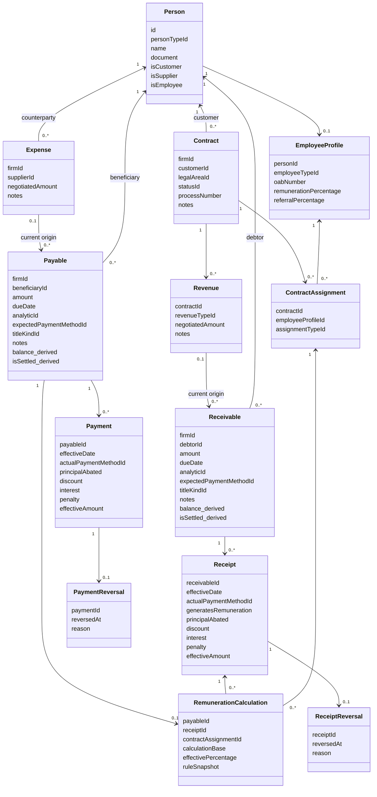
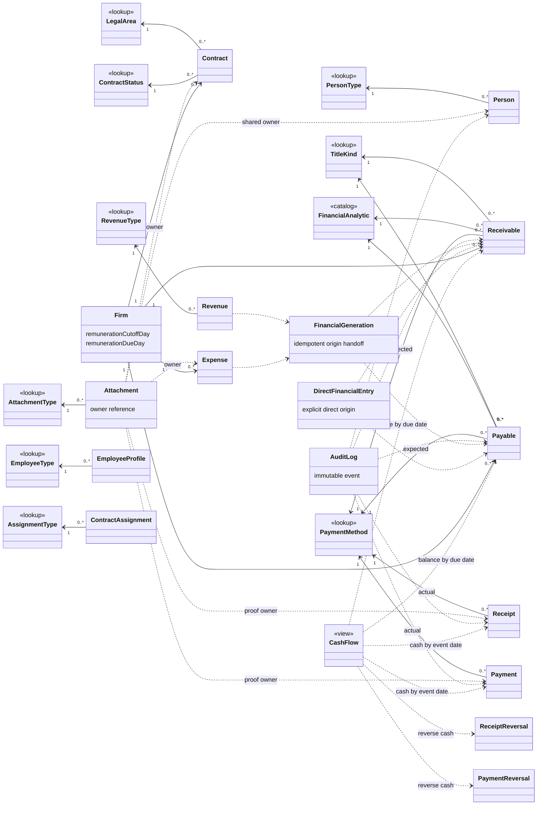

# Financial redesign UML — proposed target

Approved 2026-10-29; read [workflow and invariants](FINANCIAL_SYSTEM.md) and [authorization](FINANCIAL_AUTHORIZATION.md). Diagrams describe target design, not implemented schema. No grouping boxes. Repeated names across diagrams denote the same entity.

No month/year competence field in this version. Due dates drive forecast; effective settlement/reversal dates drive realized cash. Financial generation validates that all preview titles, including entry, exactly equal the agreed total; later authorized adjustments may change title totals without rewriting the agreement.

## Core classes

## Lookups, evidence and ownership

Lookups use id/value/label/isActive; global analytics evolve ExpenseCategory. ADMIN_ASSISTANT and existing PAYROLL_LAWYERS/PAYROLL_STAFF values are preserved. Generated titles require exactly one validated origin; optional Revenue/Expense edges do NOT mean untracked origin is allowed. DirectFinancialEntry and FinancialGeneration are proposed integrity/grouping records, not additional user-facing operational modules. Concrete FK layout is resolved in phase 03 with database-enforced exclusivity. Title kind and origin kind are different concepts.

All operational/financial children retain Firm isolation and timestamps/audit; common fields omitted. Each Attachment has exactly one enforced owner, not multiple simultaneous owners. Each Receipt/Payment owns its proof; neither ReceiptBatch nor PaymentBatch or person grouping exists. Multi-selection creates independent settlements atomically across authorized Persons in one direction and Firm, copying the common effective date and actual PaymentMethod to each event. Receipt also records the remuneration-generation choice. Technical idempotency/audit correlation is not a business lot. Other existing owner attachments remain preserved during cutover. Settlement reversals are append-only, unique per settlement, with actor/reason and event date. Financial totals/status are derived, not independently editable flags.

UI projections remain separate: Clientes, Fornecedores and Colaboradores all reference Person; Colaboradores additionally manages EmployeeProfile under explicit authorization. No separate duplicate customer/supplier/employee identity tables are implied. Member cannot use these shared relationships to read supplier/collaborator management or professional/percentage/access fields.
